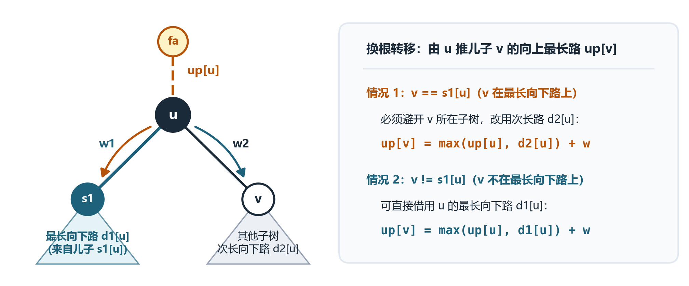
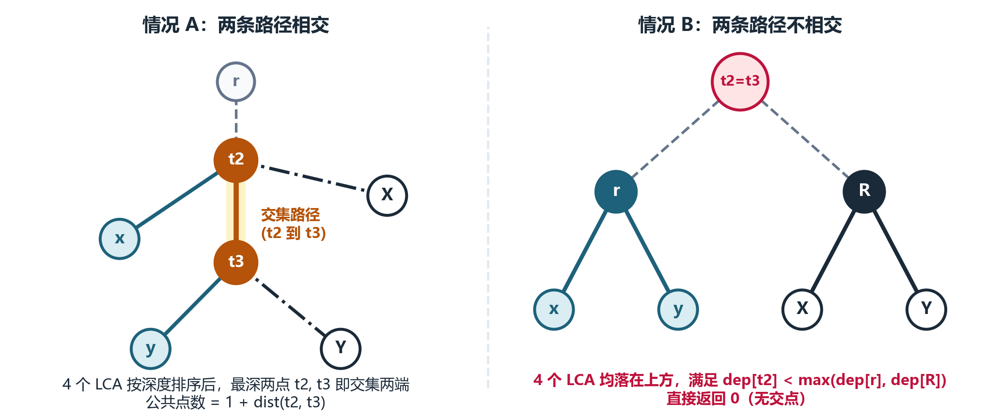
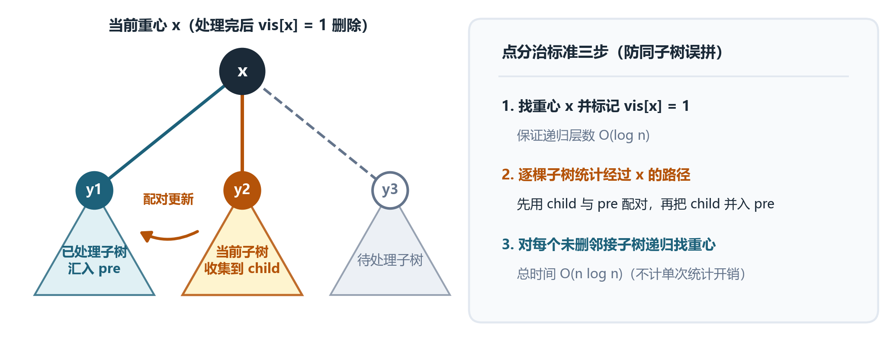

## 第二章：树论

### 树的直径、半径与中心

- **直径**：树上最远两点间的距离。边权非负时，从任意点出发找到的最远点必为直径一端（两次 DFS 即可）。
- **中心与半径**：令 $ecc(u)$ 为 $u$ 到最远点的距离（偏心距），使 $ecc(u)$ 最小的节点为**中心**，该最小值即**半径**。中心至多两个且必相邻，都在直径中点处。

#### 无权树直径

> **调用流：** `TreeDiameter T(n);` → `T.add(x, y);` → `T.getlen(root);`
>
> **复杂度：** $O(k)$ 时间与空间（$k$ 为 `root` 所在连通块点数）。
>
> **说明：** 点编号 $1\sim n$，边权均为 $1$；支持森林。使用显式栈迭代 DFS，常数小且不爆栈。

```cpp
struct TreeDiameter {
    int n;
    vector<vector<int>> ver;

    TreeDiameter(int n) : n(n), ver(n + 1) {}

    void add(int x, int y) {
        ver[x].push_back(y);
        ver[y].push_back(x);
    }

    pair<int, int> dfs(int s) {
        int pos = s, mx = 0;
        vector<array<int, 3>> st;
        st.push_back({s, 0, 0});
        while (!st.empty()) {
            array<int, 3> t = st.back();
            st.pop_back();
            int x = t[0], fa = t[1], dep = t[2];
            if (dep > mx) {
                mx = dep;
                pos = x;
            }
            for (auto y : ver[x]) {
                if (y == fa) continue;
                st.push_back({y, x, dep + 1});
            }
        }
        return {pos, mx};
    }

    int getlen(int root = 1) {
        int st = dfs(root).first;
        return dfs(st).second;
    }
};
```

#### 带权树直径、半径与中心

> **调用流：** `TreeCenter T(n);` → `T.add(u, v, w);` → `T.work(1);` → 读取 `T.center` / `T.radius` / `T.diam` 或各点偏心距 `max(T.d1[u], T.up[u])`。
>
> **复杂度：** $O(n)$ 时间与空间。
>
> **说明：** 边权非负、连通树、点编号 $1\sim n$。`d1[u]` / `d2[u]` 为 $u$ 向下最长/次长路，`s1[u]` 为最长路所在儿子，`up[u]` 为 $u$ 向上最长路。

<div class="no-break">



</div>

```cpp
struct TreeCenter {
    int n, radius, center, diam;
    vector<vector<pair<int, int>>> e;
    vector<int> d1, d2, s1, up;

    TreeCenter(int n)
        : n(n), radius(0), center(1), diam(0),
          e(n + 1), d1(n + 1), d2(n + 1), s1(n + 1), up(n + 1) {}

    void add(int u, int v, int w) {
        e[u].push_back({w, v});
        e[v].push_back({w, u});
    }

    void dfs1(int u, int fa) {
        for (auto &p : e[u]) {
            int w = p.first, v = p.second;
            if (v == fa) continue;
            dfs1(v, u);
            int x = d1[v] + w;
            if (x > d1[u]) {
                d2[u] = d1[u];
                d1[u] = x, s1[u] = v;
            } else if (x > d2[u]) {
                d2[u] = x;
            }
        }
    }

    void dfs2(int u, int fa) {
        for (auto &p : e[u]) {
            int w = p.first, v = p.second;
            if (v == fa) continue;
            up[v] = max(up[u], s1[u] == v ? d2[u] : d1[u]) + w;
            dfs2(v, u);
        }
    }

    void work(int root = 1) {
        dfs1(root, 0);
        dfs2(root, 0);
        center = 1;
        for (int i = 1; i <= n; i++) {
            if (max(d1[i], up[i]) < max(d1[center], up[center])) {
                center = i;
            }
        }
        radius = max(d1[center], up[center]);
        diam = d1[center] + max(d2[center], up[center]);
    }
};
```

### 树的重心

- **定义与性质**：删去节点 $u$ 后，若剩余各连通块的最大点数最小，则称 $u$ 为**重心**。有结论：重心至多两个且必相邻；删去节点 $u$ 后每个连通块大小均不超过 $\lfloor n/2 \rfloor$。

> **调用流：** `TreeCentroid T(n);` → `T.add(u, v);` → `T.work(1);` → 读取 `T.cog`（重心编号）与 `T.rem`（删去重心后最大连通块大小）。
>
> **复杂度：** $O(n)$ 时间与空间。
>
> **说明：** 点编号 $1\sim n$，需连通。若存在两个重心，按编号更小或任意一个时只需调整 `res < rem` 判断。

```cpp
struct TreeCentroid{
    int n, cog, rem;
    vector<vector<int>> e;
    TreeCentroid(int n) : n(n), cog(1), rem(n), e(n + 1) {}
    void add(int u, int v){
        e[u].push_back(v);
        e[v].push_back(u);
    }
    int dfs(int u, int fa){
        int s = 1, res = 0;
        for(int v : e[u]){
            if (v == fa) continue;
            int t = dfs(v, u);
            res = max(res, t);
            s += t;
        }
        res = max(res, n - s);
        if(res < rem){
            rem = res;
            cog = u;
        }
        return s;
    }
    int work(int root = 1){
        rem = n;
        cog = root;
        dfs(root, 0);
        return cog;
    }
};
```

### 倍增求最近公共祖先、间距

> **调用流：** `TreeLifting T(n);` → `T.add(x, y);` → `T.work(root);` → `T.jump(x, k)` / `T.lca(x, y)` / `T.dist(x, y)` / `T.get_root_siz(r, u)`。
>
> **复杂度：** 预处理与空间 $O(n\log n)$，单次查询 $O(\log n)$。
>
> **说明：** 无权树，点编号 $1\sim n$。`jump(x, k)` 向上跳 $k$ 层，越过原根返回 `0`；自带 `siz[]` 与任意换根查询 `get_root_siz(r, u)`。

| 接口 | 含义 | 复杂度 |
| --- | --- | --- |
| `work(root)` | 以 `root` 为根预处理倍增表、深度与子树大小 | $O(n\log n)$ |
| `jump(x, k)` | 查询 `x` 的第 $k$ 级祖先（越界返回 `0`） | $O(\log n)$ |
| `lca(x, y)` | 查询 `x` 与 `y` 的最近公共祖先 | $O(\log n)$ |
| `dist(x, y)` | 查询 `x` 与 `y` 的路径边数 | $O(\log n)$ |
| `get_root_siz(r, u)` | 查询以 `r` 为新根时 `u` 的子树大小 | $O(\log n)$ |

```cpp
struct TreeLifting{
    int n, LOG;
    vector<vector<int>> ver, up;
    vector<int> lg, dep, siz;
    TreeLifting(int n) : n(n), ver(n + 1), lg(n + 1), dep(n + 1), siz(n + 1){
        for(int i = 1; i <= n; i++){
            lg[i] = lg[i - 1] + ((1 << lg[i - 1]) == i);
        }
        LOG = lg[n] + 1;
        up.assign(n + 1, vector<int>(LOG));
    }
    void add(int x, int y){
        ver[x].push_back(y);
        ver[y].push_back(x);
    }
    void dfs(int x, int fa){
        up[x][0] = fa;
        dep[x] = dep[fa] + 1;
        siz[x] = 1;
        for(int i = 1; i <= lg[dep[x]]; i++){
            up[x][i] = up[up[x][i - 1]][i - 1];
        }
        for(int y : ver[x]){
            if (y == fa) continue;
            dfs(y, x);
            siz[x] += siz[y];
        }
    }
    int jump(int x, int k){
        if (k >= dep[x]) return 0;
        while (k > 0) {
            int i = lg[k] - 1;
            x = up[x][i];
            k -= 1LL << i;
        }
        return x;
    }
    int get_root_siz(int r, int u){
        if (r == u) return n;
        if (dep[r] <= dep[u]) return siz[u];
        int p = jump(r, dep[r] - dep[u] - 1);
        return up[p][0] == u ? n - siz[p] : siz[u];
    }
    int lca(int x, int y){
        if (dep[x] < dep[y]) swap(x, y);
        x = jump(x, dep[x] - dep[y]);
        if (x == y) return x;
        for (int k = lg[dep[x]] - 1; k >= 0; k--){
            if (up[x][k] == up[y][k]) continue;
            x = up[x][k];
            y = up[y][k];
        }
        return up[x][0];
    }
    int dist(int x, int y){
        return dep[x] + dep[y] - 2 * dep[lca(x, y)];
    }
    void work(int root = 1){
        dfs(root, 0);
    }
};
```

### 带权树上倍增求最近公共祖先、间距与路径最大边权

> **调用流：** `WeightedLifting T(n);` → `T.add(x, y, w);` → `T.work(root);` → `T.lca(x, y)` / `T.dist(x, y)` / `T.max_edge(x, y)`。
>
> **复杂度：** 预处理与空间 $O(n\log n)$，单次查询 $O(\log n)$。
>
> **说明：** 带权树，点编号 $1\sim n$。`dist(x, y)` 返回**带权距离**，`edge_dist(x, y)` 返回**路径边数**，`max_edge(x, y)` 返回路径上的**最大边权**（若允许负边权，把 `max_edge` 里的初值 `0` 改为 `-4e18`；求最小边权时把 `max` 改 `min`、初值改 `4e18`）。

| 接口 | 含义 | 复杂度 |
| --- | --- | --- |
| `lca(x, y)` | 查询最近公共祖先 | $O(\log n)$ |
| `dist(x, y)` | 查询两点间的**带权路径距离** | $O(\log n)$ |
| `edge_dist(x, y)` | 查询两点间的**路径边数** | $O(\log n)$ |
| `max_edge(x, y)` | 查询路径上的最大边权（$x=y$ 时返回 `0`） | $O(\log n)$ |

```cpp
struct WeightedLifting {
    int n, LOG;
    vector<vector<int>> up, mx;
    vector<vector<pair<int, int>>> ver;
    vector<int> lg, dep, wdis;
    WeightedLifting(int n) : n(n), ver(n + 1), lg(n + 1), dep(n + 1), wdis(n + 1){
        for (int i = 1; i <= n; i++){
            lg[i] = lg[i - 1] + ((1 << lg[i - 1]) == i);
        }
        LOG = lg[n] + 1;
        up.assign(n + 1, vector<int>(LOG));
        mx.assign(n + 1, vector<int>(LOG));
    }
    void add(int x, int y, int w){
        ver[x].push_back({y, w});
        ver[y].push_back({x, w});
    }
    void dfs(int x, int fa){
        up[x][0] = fa;
        dep[x] = dep[fa] + 1;
        for (int i = 1; i <= lg[dep[x]]; i++){
            up[x][i] = up[up[x][i - 1]][i - 1];
            mx[x][i] = max(mx[x][i - 1], mx[up[x][i - 1]][i - 1]);
        }
        for (auto &p : ver[x]){
            int y = p.first, w = p.second;
            if (y == fa) continue;
            mx[y][0] = w;
            wdis[y] = wdis[x] + w;
            dfs(y, x);
        }
    }
    int lca(int x, int y){
        if (dep[x] < dep[y]) swap(x, y);
        while (dep[x] > dep[y]) {
            x = up[x][lg[dep[x] - dep[y]] - 1];
        }
        if (x == y) return x;
        for (int k = lg[dep[x]] - 1; k >= 0; k--){
            if (up[x][k] == up[y][k]) continue;
            x = up[x][k];
            y = up[y][k];
        }
        return up[x][0];
    }
    int dist(int x, int y){
        return wdis[x] + wdis[y] - 2 * wdis[lca(x, y)];
    }
    int edge_dist(int x, int y){
        return dep[x] + dep[y] - 2 * dep[lca(x, y)];
    }
    int max_edge(int x, int y){
        auto get = [&](int u, int anc) -> int {
            int ans = 0; // 若边权可负，改为 -4e18
            if (u == anc) return ans;
            for (int i = lg[dep[u]] - 1; i >= 0; i--) {
                if (dep[up[u][i]] > dep[anc]) {
                    ans = max(ans, mx[u][i]);
                    u = up[u][i];
                }
            }
            return max(ans, mx[u][0]);
        };
        int fa = lca(x, y);
        return max(get(x, fa), get(y, fa));
    }
    void work(int root = 1){
        dfs(root, 0);
    }
};
```

### 树上路径交

> **调用流：** 先预处理任意 LCA 封装（提供 `lca`、`dist`、`dep`），再调用 `intersection(x, y, X, Y)`。
>
> **复杂度：** 单次查询 $O(\log n)$（共求 6 次 LCA）。
>
> **说明：** 返回两条路径 $(x, y)$ 与 $(X, Y)$ 的**公共节点数**（`0` 表示不相交）。若题目需要交集路径的两个端点，相交时直接取 `{t[2], t[3]}`。

<div class="no-break">



</div>

```cpp
int intersection(int x, int y, int X, int Y) {
    vector<int> t = {lca(x, X), lca(x, Y), lca(y, X), lca(y, Y)};
    sort(t.begin(), t.end(), [&](int a, int b) { return dep[a] < dep[b]; });
    int r = lca(x, y), R = lca(X, Y);
    if (dep[t[2]] < max(dep[r], dep[R])) return 0;
    return 1 + dist(t[2], t[3]);
}
```

### 相邻方向断边子树大小

> **调用流：** 双向加边 → `dfs(1)` → `get_siz(p, u)`。
>
> **复杂度：** 预处理 $O(n)$，单次查询 $O(1)$。
>
> **使用条件：** 无根树，点编号 $1\sim n$；`get_siz(p, u)` 中的 `p` 与 `u` **必须相邻**。如果这两个点不相邻，请使用 **2.3 `TreeLifting`** 模板。

```cpp
const int N = 200005;
vector<int> g[N];
int n, fa[N], siz[N];

void dfs(int u, int p = 0) {
    fa[u] = p;
    siz[u] = 1;
    for (int v : g[u]) {
        if (v == p) continue;
        dfs(v, u);
        siz[u] += siz[v];
    }
}

int get_siz(int p, int u) {
    return fa[u] == p ? siz[u] : n - siz[p];
}
```

### 点分治

> **用途：** 统计树上满足特定条件的路径（下方示例：判定是否存在长度为 $q_i$ 的路径）。
>
> **调用流：** 建好带权邻接表 `ver` → `get(get, 1, 0, n); dfz(dfz, root, 0);` → 读取 `ans[i]`。
>
> **复杂度：** 递归层数 $O(\log n)$，每层遍历 $O(n)$，总分治框架 $O(n\log n)$。
>
> **易错点：** 每次调用 `get` 找子树重心前必须重置 `MaxTree = 1e18`；`vis[x]` 表示已分治删除的重心，不可提前清空。

<div class="no-break">



</div>

```cpp
// 前置全局：n, m, ver[n+1]（pair<int,int> 存 {点, 边权}）, q[m+1], ans[m+1]
int root = 0, MaxTree = 1e18;
vector<int> vis(n + 1), siz(n + 1);

auto get = [&](auto self, int x, int fa, int tot) -> void { // 找当前连通块重心
    siz[x] = 1;
    int val = 0;
    for (auto &p : ver[x]) {
        int y = p.first;
        if (y == fa || vis[y]) continue;
        self(self, y, x, tot);
        siz[x] += siz[y];
        val = max(val, siz[y]);
    }
    val = max(val, tot - siz[x]);
    if (val < MaxTree) {
        MaxTree = val;
        root = x;
    }
};

auto calc = [&](int x) -> void { // === [按题修改区] 统计经过重心 x 的路径 ===
    unordered_set<int> pre = {0}; // 此前已处理子树中到 x 的距离集合
    vector<int> dis(n + 1);
    for (auto &p : ver[x]) {
        int y = p.first, w = p.second;
        if (vis[y]) continue;
        vector<int> child;
        auto dfs = [&](auto self, int u, int fa) -> void {
            child.push_back(dis[u]);
            for (auto &ed : ver[u]) {
                int ny = ed.first, nw = ed.second;
                if (ny == fa || vis[ny]) continue;
                dis[ny] = dis[u] + nw;
                self(self, ny, u);
            }
        };
        dis[y] = w;
        dfs(dfs, y, x);

        for (auto it : child) {
            for (int i = 1; i <= m; i++) {
                if (q[i] < it || !pre.count(q[i] - it)) continue;
                ans[i] = 1;
            }
        }
        pre.insert(child.begin(), child.end());
    }
};

auto dfz = [&](auto self, int x, int fa) -> void { // 点分治主过程
    vis[x] = 1;
    calc(x);
    for (auto &p : ver[x]) {
        int y = p.first;
        if (y == fa || vis[y]) continue;
        MaxTree = 1e18;
        get(get, y, x, siz[y]);
        self(self, root, x);
    }
};

get(get, 1, 0, n);
dfz(dfz, root, 0);
```

### 树上启发式合并

> **用途：** 无修改的树上子树统计，统一求出所有节点 $u$ 的子树答案（下方示例：求子树内出现次数最多的颜色编号之和）。
>
> **调用流：** 定义全局 `color[]` → `DSUOnTree T(n);` → `T.add(u, v);` → `T.work(1);` → 读取 `T.ans[u]`。
>
> **复杂度：** 预处理 $O(n)$，启发式合并 $O(n\log n)$，空间 $O(n)$。
>
> **核心思路：** 先算轻儿子并清空贡献，再算重儿子并**保留**贡献，最后把轻儿子暴力合并进来得到当前点答案；若当前点本身是轻儿子，算完后再清空。

```cpp
// 前置全局：color[n+1]（节点颜色，值域 1..n）
struct DSUOnTree {
    vector<vector<int>> e;
    vector<int> siz, son, cnt, ans;
    int sum, Max, hson;

    DSUOnTree(int n)
        : e(n + 1), siz(n + 1), son(n + 1), cnt(n + 1), ans(n + 1),
          sum(0), Max(0), hson(0) {}

    void add(int u, int v) {
        e[u].push_back(v);
        e[v].push_back(u);
    }

    void dfs1(int u, int fa) {
        siz[u] = 1;
        for (int v : e[u]) {
            if (v == fa) continue;
            dfs1(v, u);
            siz[u] += siz[v];
            if (siz[v] > siz[son[u]]) son[u] = v;
        }
    }

    void calc(int u, int fa, int val) { // === [按题修改区] 单点增删贡献 ===
        cnt[color[u]] += val;
        if (val > 0) {
            if (cnt[color[u]] > Max) {
                Max = cnt[color[u]];
                sum = color[u];
            } else if (cnt[color[u]] == Max) {
                sum += color[u];
            }
        }
        for (int v : e[u]) {
            if (v == fa || v == hson) continue;
            calc(v, u, val);
        }
    }

    void dfs2(int u, int fa, int keep) {
        for (int v : e[u]) {
            if (v == fa || v == son[u]) continue;
            dfs2(v, u, 0);
        }
        if (son[u]) {
            dfs2(son[u], u, 1);
            hson = son[u]; // 统计时跳过已保留的重儿子
        }
        calc(u, fa, 1);
        hson = 0;
        ans[u] = sum;
        if (!keep) {
            calc(u, fa, -1);
            sum = 0;
            Max = 0;
        }
    }

    void work(int root = 1) {
        dfs1(root, 0);
        dfs2(root, 0, 0);
    }
};
```

<div style="page-break-after:always">/END/</div>
