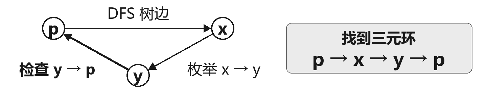
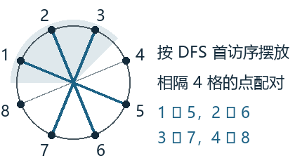
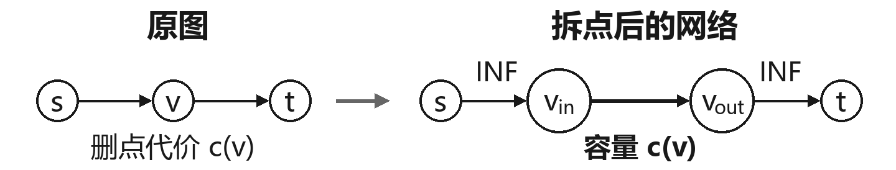
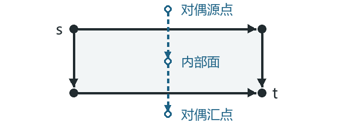
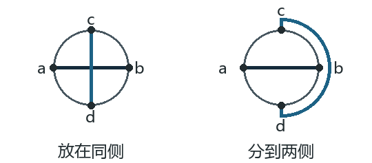

### 图论常见结论与例题

#### 缩点、补边与判环

- **最多选多少点，使任意两点至少有一个方向能到达？** 先把每个强连通分量（SCC）缩成一个点，点权取分量大小，再求缩点图上点权和最大的路径。
- **从哪些点出发可以一直走下去？** 反复删掉没有出边的点。最后剩下的点恰好都能走到某个环。实现时在反图上做拓扑删除。
- **最少补几条有向边才能全图强连通？** 先缩点。只有一个分量时答案为 $0$，否则答案是「入度为 $0$ 的分量数」和「出度为 $0$ 的分量数」中的较大值。要求输出补边方案时，还要考虑缩点图上的可达关系。
- **最少补几条无向边才能消掉所有桥？** 原图连通且允许所需补边时，把边双连通分量缩成桥树。若有 $L$ 个度数为 $1$ 的点，答案为 $\lceil L/2\rceil$。缩点后只有一个点时答案为 $0$。
- **只判有无环。** 有向图看拓扑排序能否取出所有点。无向图逐条加边时，若新边两端已在同一个并查集里，就会成环。无向连通图恰有一个环时，反复删除度数为 $1$ 的点，剩下的就是环。
- **把树补成边尽量多的简单二分图。** 二染色后两侧各有 $a,b$ 个点，补齐所有异色点之间的缺边，共能补 $ab-(n-1)$ 条。

#### 竞赛图

任意两个不同的点之间恰好有一条单向边，这种图叫竞赛图。

- **两步可达。** 若 $u$ 的入度不大于 $v$ 的入度，则 $u$ 最多走两条边就能到 $v$。
- **按入度划分 SCC。** 入度升序排列，前 $i$ 个点的入度和若等于 $i(i-1)/2$，就在第 $i$ 个点后切开。相邻切口之间是一整个 SCC。等式表示前缀的入度全来自内部边。
- **找三元环。** 竞赛图只要有环，就有三元环。DFS 时对每条树边 $p\to x$，枚举 $x$ 的所有出邻点 $y$，包括已访问的点。若 $y\to p$，就找到了 $p\to x\to y\to p$。整张图都搜过仍找不到就无环。用邻接矩阵耗时 $O(N^2)$。
- **数三元环。** 答案为 $\binom N3-\sum_v\binom{d^+(v)}2$，其中 $d^+(v)$ 是出度。一个三点组没有环时，恰好有一个点同时指向另外两个点。



<div class="no-break">

#### 树上配对与生成树计数

**树上配对，使距离总和最大。** 把 $2n$ 个点两两配对，每个点用一次。删掉边 $e$ 后，若一侧有 $s_e$ 个点，跨过这条边的点对至多有 $\min(s_e,2n-s_e)$ 个。边权 $w_e$ 非负时，最大距离和为 $\sum_e w_e\min(s_e,2n-s_e)$，统计一遍子树大小即可。

**怎样同时取到每条边的上界？** 将 DFS 首访序首尾相接，前半段和后半段按位置配对。任意树边切出的较小一侧，在圆上都是一段至多 $n$ 个点的连续区间。这一段放不下两个相隔 $n$ 格的点，因此段里的每个点都配到了对面。图中灰底的 3 个点各有一条配对线跨到另一侧。



</div>

**Prüfer 计数。** 点有各自的编号，编号不同的点视为不同点。

- $n$ 个点的有标号无根树有 $n^{n-2}$ 棵，有根树有 $n^{n-1}$ 棵。$n=1$ 时均为 $1$。
- 指定各点度数 $d_i$ 且 $n\ge 2$ 时，若所有 $d_i\ge1$ 且 $\sum_i d_i=2(n-1)$，答案为 $(n-2)!/\prod_i(d_i-1)!$，否则为 $0$。
- 已有 $k$ 个连通块，大小为 $s_i$。可以任意跨块加边，恰加 $k-1$ 条让图连通的方案数为 $n^{k-2}\prod_i s_i$。$k=1$ 时答案为 $1$。

**矩阵树定理（无向图）。** 数给定图里的生成树时，先开一个全零矩阵 $L$。每条边 $(u,v,w)$ 让 $L_{uu},L_{vv}$ 各加 $w$，$L_{uv},L_{vu}$ 各减 $w$。重边分别加，自环跳过。删去同一个点对应的行和列，求剩余矩阵的行列式。所有 $w=1$ 时得到树的棵数，带权时得到各棵树的边权乘积之和。模质数用第 05A 章的 `detModPrime`，时间 $O(N^3+M)$。

#### 删点、删边与平面图

**最小代价让 $s$ 到不了 $t$。** 删边就把代价作为容量求最小割。删点就把每个可删点拆成入点和出点，它们之间连一条容量等于删除代价的边。原边从出点接到入点，容量要大于所有可删点的总代价，$s,t$ 保留。无向边按两个方向加边。



**平面图最小割。** 已知图怎么画，且 $s,t$ 在同一个面的边界上时，可把这个面放在最外面。每个面变成对偶图的一个点，外部面沿 $s,t$ 之间的两段边界拆成两个点。从对偶源点到对偶汇点的路每跨过一条原边，就付这条边的割代价。原边有向时，沿原边看，对偶边从左侧面指向右侧面。图中沿蓝线从对偶源点走向汇点，原图的 $s$ 在右手边，$t$ 在左手边。有向图按这个方向区分两个外部面。原边无向时对偶边连两个方向。边权非负，用 Dijkstra。



**欧拉公式与边数上界。** 连通平面图有 $N-M+F=2$，外部面也计入 $F$。简单平面图在 $N\ge3$ 时至多有 $3N-6$ 条边，若还是二分图则至多有 $2N-4$ 条边。

<div class="no-break">

**给定哈密顿环，能否画成平面图？** 先沿给定的环给点依次编号。两条弦若有四个不同端点且沿环交错，例如 $a<c<b<d$，就必须画在环的两侧。每条弦看成一个点，给每对交错的弦连边，能二染色就能画。



</div>

#### 单源最短与严格次短游走计数

对每个点保留两个**不同**的距离和各自条数。每条边必须是正权，因为到达某个状态的所有走法要在它出堆前计完。允许重复走同一个点或边，平行边分别计数。点从 1 编号，计数用第 08 章的模整数 `Z`，要统计的距离须小于 `INF`。时间 $O(N+M\log(M+1))$，空间 $O(N+M)$。

```c++
struct ShortestPathCounter {
    static constexpr int INF = 1e18;
    vector<vector<pair<int, int>>> ver;
    vector<array<int, 2>> dis;
    vector<array<Z, 2>> num;
    ShortestPathCounter(int n) : ver(n + 1), dis(n + 1), num(n + 1) {}
    void add(int x, int y, int w) { ver[x].emplace_back(y, w); }
    void work(int s) {
        fill(dis.begin(), dis.end(), array<int, 2>{INF, INF});
        fill(num.begin(), num.end(), array<Z, 2>{0, 0});
        using State = array<int, 3>; // 距离、点、名次
        priority_queue<State, vector<State>, greater<State>> q;
        dis[s][0] = 0;
        num[s][0] = 1;
        q.push({0, s, 0});
        while (!q.empty()) {
            auto cur = q.top();
            q.pop();
            int d = cur[0], x = cur[1], k = cur[2];
            if (d != dis[x][k]) continue;
            for (auto e : ver[x]) {
                int y = e.first, w = e.second;
                if (w >= INF - d) continue;
                int nd = d + w;
                Z ways = num[x][k];
                if (nd < dis[y][0]) {
                    dis[y][1] = dis[y][0];
                    num[y][1] = num[y][0];
                    if (dis[y][1] != INF) q.push({dis[y][1], y, 1});
                    dis[y][0] = nd;
                    num[y][0] = ways;
                    q.push({nd, y, 0});
                } else if (nd == dis[y][0]) {
                    num[y][0] += ways;
                } else if (nd < dis[y][1]) {
                    dis[y][1] = nd;
                    num[y][1] = ways;
                    q.push({nd, y, 1});
                } else if (nd == dis[y][1]) {
                    num[y][1] += ways;
                }
            }
        }
    }
};
constexpr int ShortestPathCounter::INF;
```

`work(s)` 后，`dis[t][0]`、`dis[t][1]` 是两种距离，`num[t][0]`、`num[t][1]` 是对应条数。距离为 `INF` 表示这一类走法不存在。无向边要正反各加一次。

<div class="no-break">

#### 输出任意一个环

DFS 中遇到一条指向当前搜索栈的边，就沿父边回溯来取环。无向边的两份记录共用边号，只跳过来时的**那条边**，这样两条重边也能组成环。允许自环、重边及非连通图，时间和空间均为 $O(N+M)$。

```c++
struct CycleFinder {
    int n, m = 0;
    bool directed;
    vector<vector<pair<int, int>>> ver;
    CycleFinder(int n, bool directed)
        : n(n), directed(directed), ver(n + 1) {}
    void add(int x, int y) {
        ver[x].emplace_back(y, ++m);
        if (!directed) ver[y].emplace_back(x, m);
    }
    pair<vector<int>, vector<int>> work() {
        vector<int> state(n + 1), next(n + 1), parent(n + 1), from(n + 1), stk;
        for (int s = 1; s <= n; ++s) {
            if (state[s]) continue;
            state[s] = 1;
            stk.push_back(s);
            while (!stk.empty()) {
                int x = stk.back();
                if (next[x] == (int)ver[x].size()) {
                    state[x] = 2;
                    stk.pop_back();
                    continue;
                }
                auto e = ver[x][next[x]++];
                int y = e.first, id = e.second;
                if (!directed && id == from[x]) continue;
                if (!state[y]) {
                    parent[y] = x;
                    from[y] = id;
                    state[y] = 1;
                    stk.push_back(y);
                } else if (state[y] == 1) {
                    vector<int> points, edges{id};
                    for (int u = x; u != y; u = parent[u]) {
                        points.push_back(u);
                        edges.push_back(from[u]);
                    }
                    points.push_back(y);
                    reverse(points.begin(), points.end());
                    reverse(edges.begin(), edges.end());
                    return {points, edges};
                }
            }
        }
        return {};
    }
};
```

`CycleFinder(n,true)` 用于有向图，`false` 用于无向图。点号和边号从 1 开始，边号按加边顺序给出。`work()` 返回点序列和边序列，第 $i$ 条边从第 $i$ 个点走到下一个点，末边回到起点。两序列为空表示无环。

</div>

#### 无向图最小环长度

下面两种做法都用于无自环、无重边的图。有自环或重边时，先单独考虑长度为一条边或两条边的环。

**非负权用 Floyd。** 枚举环中编号最大的点 $k$。在 Floyd 第 $k$ 轮松弛**之前**，`dis[i][j]` 只经过编号小于 $k$ 的中间点，接上 $i-k$ 和 $k-j$ 就能得到备选环。输入从 1 编号的对称矩阵，对角线填 0，缺边填 `inf`。无环返回 `inf`，有限答案需小于它。时间 $O(N^3)$，空间 $O(N^2)$。

```c++
int floyd(vector<vector<int>> dis, int inf) {
    const auto edge = dis;
    const int n = (int)dis.size() - 1;
    int ans = inf;
    for (int k = 1; k <= n; ++k) {
        for (int i = 1; i < k; ++i) {
            for (int j = 1; j < i; ++j) {
                if (dis[i][j] == inf || edge[i][k] == inf || edge[k][j] == inf) continue;
                __int128 length = (__int128)dis[i][j] + edge[i][k] + edge[k][j];
                if (length < ans) ans = static_cast<int>(length);
            }
        }
        for (int i = 1; i <= n; ++i) {
            for (int j = 1; j <= n; ++j) {
                if (dis[i][k] == inf || dis[k][j] == inf) continue;
                __int128 length = (__int128)dis[i][k] + dis[k][j];
                if (length < dis[i][j]) dis[i][j] = static_cast<int>(length);
            }
        }
    }
    return ans;
}
```

**无权图用逐点 BFS。** 从每个点跑一遍 BFS，发现非树边 $x-y$ 时尝试用 `dis[x]+dis[y]+1` 更新答案。扫遍所有起点后最小值就是最短环。输入从 1 编号的双向邻接表，无环返回 `-1`。时间 $O(N(N+M))$，额外空间 $O(N)$。

```c++
int minCycleBfs(const vector<vector<int>> &g) {
    int n = (int)g.size() - 1, ans = n + 1;
    for (int s = 1; s <= n; ++s) {
        vector<int> dis(n + 1, -1), parent(n + 1), q{s};
        dis[s] = 0;
        for (int i = 0; i < (int)q.size(); ++i) {
            int x = q[i];
            for (int y : g[x]) {
                if (dis[y] == -1) {
                    dis[y] = dis[x] + 1;
                    parent[y] = x;
                    q.push_back(y);
                } else if (parent[x] != y && parent[y] != x) {
                    ans = min(ans, dis[x] + dis[y] + 1);
                }
            }
        }
    }
    return ans <= n ? ans : -1;
}
```

#### 无向图简单环计数

固定每个环编号最小的点为起点。状态记录经过的点集和当前终点，能连回起点时就计一次。最后减去沿同一条边走来回的 $M$ 条走法，再除以 2，因为每个环正反各算了一次。

点从 0 编号，图无自环、无重边。时间 $O((N+M)2^N)$，DP 内存约 $8N2^N$ 字节，$N=21$ 时已超过 256 MiB。中间计数和答案均须能放入 `int`。

```c++
struct SimpleCycleCounter {
    int n;
    vector<vector<int>> G;
    SimpleCycleCounter(int n) : n(n) {
        G.resize(n);
    }
    void add(int u, int v) { // 0-indexed
        G[u].push_back(v);
        G[v].push_back(u);
    }
    int work() {
        const int masks = 1LL << n;
        vector<int> dp(masks * n);
        auto ways = [&](int mask, int u) -> int& { return dp[mask * n + u]; };
        for (int i = 0; i < n; i++) ways(1LL << i, i) = 1;
        int ans = 0, m = 0;
        for (int u = 0; u < n; ++u) {
            m += G[u].size();
        }
        m /= 2;
        for (int st = 1; st < masks; st++) {
            for (int u = 0; u < n; u++) {
                if (!ways(st, u)) continue;
                int start = st & -st;
                for (auto v : G[u]) {
                    if ((1LL << v) < start) continue;
                    if ((1LL << v) & st) {
                        if ((1LL << v) == start) {
                            ans += ways(st, u);
                        }
                    } else {
                        ways(st | (1LL << v), v) += ways(st, u);
                    }
                }
            }
        }
        return (ans - m) / 2;
    }
};
```

<div style="page-break-after:always">/END/</div>
