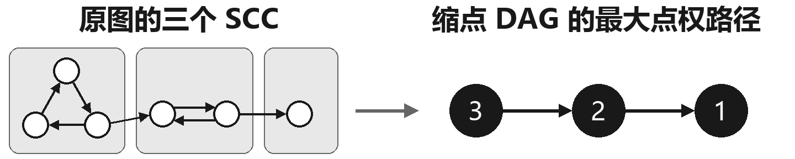
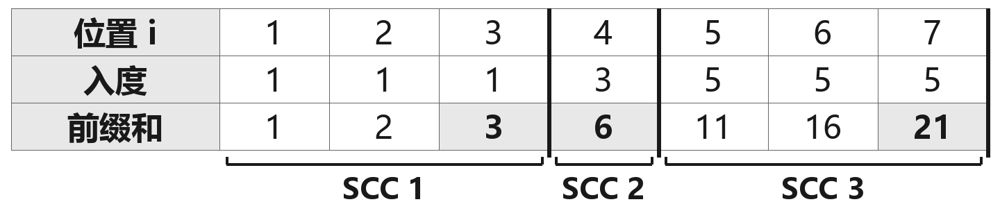
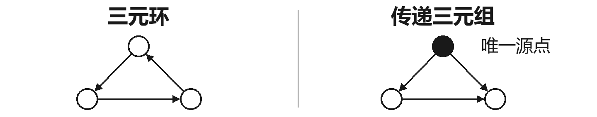

### 常见结论

1. **构造生成树。** 如果想构造一棵连通无向图的生成树，从任意点跑一次 BFS 或 DFS，保留每个非起点第一次被发现时经过的边即可。
2. **树上补边。** 如果想给一棵 $n$ 个点的树尽可能多地加边，并让它仍是简单二分图，就先做二染色，再补齐异色点之间的缺边。两种颜色分别有 $a,b$ 个点时，最多能加 $ab-(n-1)$ 条边。
3. **二分图的度数和。** 在任意二分图中，左部所有点的度数之和、右部所有点的度数之和都等于总边数。
4. **竞赛图的两步可达性。** 在任意两点间恰有一条单向边的竞赛图中，如果 $u$ 的入度不大于 $v$，那么从 $u$ 出发，至多经过两条边就能到达 $v$。
5. **平面图的边数上界。** 对有 $n\ge 3$ 个顶点的简单平面图，边数至多为 $3n-6$。如果它还是二分图，边数至多为 $2n-4$。判定平面性时，可以先用这些上界排除边数超限的图。
6. **竞赛图中的环。** 在竞赛图中，只要存在有向环，就一定存在由三个点组成的有向环。
7. **判环与找环。** 判断有向图是否有环，可以做一次拓扑排序。判断无向图逐条加边时何时成环，可以用并查集检查新边的两个端点是否已连通。若已知无向连通图恰有一个环，反复删除度数不超过 $1$ 的点，剩下的点恰好构成这个环。
8. **给定一张有向图，最多能选多少个点，使每对选中的点至少有一个方向可达？** 先把每个 SCC 缩成一点，以分量大小为点权，再求缩点 DAG 上的最大点权路径。



9. **给定竞赛图中每个点的入度，如何划分这张图的强连通分量？** 把点按入度升序排列，每当前 $i$ 个点的入度和等于 $i(i-1)/2$，就在第 $i$ 个点后切开。相邻切口之间的点构成一个 SCC。达到等号时，前缀的入度恰好都来自内部边。



10. **给定一张有向图和两点 $s,t$，怎样以最小代价删边或删点，让 $s$ 无法到达 $t$？** 删边时，把删除代价设为容量，求 $s$ 到 $t$ 的最小割。删点时，保留 $s,t$，把可删点拆成入点和出点，中间边的容量取删除代价。原边从出点接到入点，容量用 $\mathrm{INF}$，取值大于所有可删点的总代价。对无向图，先将每条边换成两个方向的边，即可求指定两点之间的割。若要求让整张无向图断开，则求全局最小割。


11. **数竞赛图的三元环。** 先数所有三点组，再减掉传递三元组。每个传递三元组恰有一个点指向另外两点，所以答案是 $\binom{n}{3}-\sum_v\binom{d^+(v)}{2}$，其中 $d^+(v)$ 是 $v$ 的出度。



### 常见例题

#### 杂

题意：给出一棵节点数为 $2n$ 的树，要求将点分割为 $n$ 个点对，使得点对的点之间的距离和最大。

可以转化为边上问题：对于每一条边，其被利用的次数即为 $\min {\{ \text{其左边的点的数量}, \text{其右边的点的数量}\}}$ ，使用树形 $\tt dp$ 计算一遍即可。如下图样例，答案为 $10$ 。


```c++
struct TreePairDistanceSum {
    int n;
    vector<vector<int>> ver;
    vector<int> siz;
    TreePairDistanceSum(int n) : n(n) {
        ver.resize(2 * n + 1);
        siz.resize(2 * n + 1);
    }
    void add(int x, int y) {
        ver[x].push_back(y);
        ver[y].push_back(x);
    }
    int dfs(int x, int fa, int k, int &ans) {
        siz[x] = 1;
        for (auto y : ver[x]) {
            if (y == fa) continue;
            dfs(y, x, k, ans);
            siz[x] += siz[y];
            ans += min(siz[y], k - siz[y]);
        }
        return siz[x];
    }
    int work(int root = 1) {
        fill(siz.begin(), siz.end(), 0);
        int k = 2 * n, ans = 0;
        dfs(root, 0, k, ans);
        return ans;
    }
};
```

用法：若原树点数为 `2n`，先 `TreePairDistanceSum G(n);`，再 `G.add(x, y);` 加边。调用 `G.work();` 返回把点分成 `n` 对时距离和的最大值。

***

题意：以哪些点为起点可以无限的在有向图上绕

概括一下这些点可以发现，一类是环上的点，另一类是可以到达环的点。建反图跑一遍 topsort 板子，根据容斥，未被移除的点都是答案 [See](https://atcoder.jp/contests/abc245/tasks/abc245_f) 。

***

题意：添加最少的边，使得有向图变成一个 SCC

将原图的 SCC 缩点，统计缩点后的新图上入度为 $0$ 和出度为 $0$ 的点的数量 $cnt_{\tt in}、cnt_{\tt out}$ ，答案即为 $\max(cnt_{\tt in}, cnt_{\tt out})$ 。过程大致是先将一个出度为 $0$ 的点和一个入度为 $0$ 的点相连，剩下的点随便连 [See](https://www.acwing.com/problem/content/369/) 。

***

题意：添加最少的边，使得无向图变成一个 E-DCC

将原图的 E-DCC 缩点，统计缩点后的新图上入度为 $1$ 的点（叶子结点）的数量 $cnt$ ，答案即为 $\left \lceil \frac{cnt}{2} \right \rceil$ 。过程大致是每次找两个叶子结点（但是还有一些条件限制）相连，若最后余下一个点随便连 [See](https://www.acwing.com/problem/content/397/) 。

***

题意：在树上找到一个最大的连通块，使得这个联通内点权和边权之和最大，输出这个值，数据中存在负数的情况。

使用 dfs 即可解决。

```c++
struct TreeMaxConnectedBlock {
    int n;
    vector<vector<pair<int, int>>> ver;
    vector<int> point, dp;
    TreeMaxConnectedBlock(int n) : n(n) {
        ver.resize(n + 1);
        point.resize(n + 1);
        dp.resize(n + 1);
    }
    void setPoint(int x, int w) {
        point[x] = w;
    }
    void add(int x, int y, int w) {
        ver[x].push_back({y, w});
        ver[y].push_back({x, w});
    }
    void dfs(int x, int fa) {
        dp[x] = point[x];
        for (const auto &e : ver[x]) {
            int y = e.first, w = e.second;
            if (y == fa) continue;
            dfs(y, x);
            dp[x] += max(dp[y] + w, 0LL);
        }
    }
    int work(int root = 1) {
        dfs(root, 0);
        int ans = -1E18;
        for (int i = 1; i <= n; ++i) {
            ans = max(ans, dp[i]);
        }
        return ans;
    }
};
```

用法：先 `TreeMaxConnectedBlock G(n);`，用 `G.setPoint(i, w);` 赋点权，再 `G.add(x, y, w);` 加边权。调用 `G.work();` 返回点权和边权和最大的连通块权值。

***

#### Prüfer 序列：凯莱公式

题意：给定 $n$ 个顶点，可以构建出多少棵标记树？


$n\le 4$ 时的样例如上，通项公式为 $n^{n-2}$ 。

#### Prüfer 序列

一个 $n$ 个点 $m$ 条边的带标号无向图有 $k$ 个连通块。我们希望添加 $k-1$ 条边使得整个图连通，求方案数量 [See](https://codeforces.com/contest/156/problem/D) 。

设 $s_i$ 表示每个连通块的数量，通项公式为 $\displaystyle n^{k-2}\cdot\prod_{i=1}^ks_i$ ，当 $k < 2$ 时答案为 $1$ 。

#### 单源最短/次短路计数

> **用途：** 同时统计最短路和严格次短路的条数。
>
> **复杂度：** $O(N+M\log(M+1))$ 时间，$O(N+M)$ 空间。
>
> **使用条件：** 只接受正边权；计数使用数据结构章的 Z。

前置依赖为《数据结构》的模整数 Z。每条边须为正权。

```c++
struct ShortestPathCounter {
    static constexpr int INF = 1e18;
    int n;
    vector<vector<pair<int, int>>> ver;
    vector<array<int, 2>> dis, vis;
    vector<array<Z, 2>> num; // 0 代表最短路条数，1 代表次短路条数
    ShortestPathCounter(int n) : n(n) {
        ver.resize(n + 1);
        dis.resize(n + 1);
        vis.resize(n + 1);
        num.resize(n + 1);
    }
    void add(int x, int y, int w) {
        ver[x].push_back({y, w});
    }
    void init() {
        for (int i = 1; i <= n; ++i) {
            dis[i] = {INF, INF};
            vis[i] = {0, 0};
            num[i] = {0, 0};
        }
    }
    void work(int s) {
        init();
        using TIII = array<int, 3>; // {距离, 点, 类型}
        priority_queue<TIII, vector<TIII>, greater<TIII>> q;
        dis[s][0] = 0;
        num[s][0] = 1;
        q.push({0, s, 0});
        while (!q.empty()) {
            auto distData = q.top();
            auto dist = get<0>(distData);
            auto x = get<1>(distData);
            auto type = get<2>(distData);
            q.pop();
            if (vis[x][type]) continue;
            vis[x][type] = 1;
            for (const auto &e : ver[x]) {
                int y = e.first, w = e.second;
                int nd = dist + w;
                if (dis[y][0] > nd) {
                    dis[y][1] = dis[y][0];
                    num[y][1] = num[y][0];
                    q.push({dis[y][1], y, 1});
                    dis[y][0] = nd;
                    num[y][0] = num[x][type];
                    q.push({dis[y][0], y, 0});
                } else if (dis[y][0] == nd) {
                    num[y][0] += num[x][type];
                } else if (dis[y][1] > nd) {
                    dis[y][1] = nd;
                    num[y][1] = num[x][type];
                    q.push({dis[y][1], y, 1});
                } else if (dis[y][1] == nd) {
                    num[y][1] += num[x][type];
                }
            }
        }
    }
    Z answer(int t) {
        Z ans = num[t][0];
        if (dis[t][1] == dis[t][0] + 1) {
            ans += num[t][1]; // 只有在次短路恰好多 1 时才计入
        }
        return ans;
    }
};
constexpr int ShortestPathCounter::INF;
```

用法：先 `ShortestPathCounter G(n);` ，再用 `G.add(x, y, w);` 建边。调用 `G.work(s);` 后，`G.answer(t)` 返回从 `s` 到 `t` 的“最短路条数 + 长度恰好多 1 的次短路条数”。

#### 输出任意一个三元环

原题：给出一张有向完全图，输出任意一个三元环上的全部元素 [See](https://codeforces.com/problemset/problem/117/C) 。使用 dfs，复杂度 $\mathcal O(N+M)$，可以扩展到非完全图和无向图。

```c++
struct TriangleFinder {
    int n;
    vector<vector<int>> a;
    vector<int> vis;
    vector<int> ans;
    TriangleFinder(int n) : n(n) {
        a.assign(n + 1, vector<int>(n + 1));
        vis.assign(n + 1, 0);
    }
    void add(int x, int y) {
        a[x][y] = 1;
    }
    bool dfs(int x, int fa) {
        vis[x] = 1;
        for (int y = 1; y <= n; ++y) {
            if (!a[x][y]) continue;
            if (fa != -1 && a[y][fa]) {
                ans = {fa, x, y};
                return true;
            }
            if (!vis[y] && dfs(y, x)) { // 这一步的 if 判断很关键
                return true;
            }
        }
        return false;
    }
    vector<int> work() {
        fill(vis.begin(), vis.end(), 0);
        ans.clear();
        for (int i = 1; i <= n; ++i) {
            if (!vis[i] && dfs(i, -1)) {
                return ans;
            }
        }
        return {};
    }
};
```

用法：先 `TriangleFinder G(n);` ，再对每条有向边调用 `G.add(x, y);`。调用 `auto cyc = G.work();`，若返回空数组则不存在三元环，否则 `cyc` 中即为任意一个三元环上的三个点。

#### 带权最小环大小与计数

> **用途：** 求有向最小环长度，并对最短环条数取模。
>
> **复杂度：** $O(N^3)$ 时间，$O(N^2)$ 空间。
>
> **使用条件：** 边权严格为正，模数正整数，最小环长度小于 INF。等权重边按边编号区分，自环计入。

原题：给出一张有向带权图，求解图上最小环的长度、有多少个这样的最小环 [See](https://acm.hdu.edu.cn/contest/problem?cid=1097&pid=1011) 。使用 floyd，复杂度为 $\mathcal O(N^3)$ ，可以扩展到无向图。

```c++
struct DirectedMinCycleCounter {
    static constexpr int INF = 1e18;
    int n, mod;
    vector<vector<int>> edge, multiplicity;

    DirectedMinCycleCounter(int n, int mod)
        : n(n), mod(mod), edge(n + 1, vector<int>(n + 1, INF)),
          multiplicity(n + 1, vector<int>(n + 1)) { assert(mod > 0); }

    void add(int x, int y, int w) {
        assert(0 < w && w < INF);
        if (w < edge[x][y]) {
            edge[x][y] = w;
            multiplicity[x][y] = 1 % mod;
        } else if (w == edge[x][y]) {
            multiplicity[x][y] = (multiplicity[x][y] + 1) % mod;
        }
    }
    pair<int, int> work() const {
        auto dis = edge, cnt = multiplicity;
        int best = INF, ways = 0;
        auto addWays = [&](int &x, int y) { x = ((__int128)x + y) % mod; };
        auto record = [&](int length, int count) {
            if (length >= INF) return;
            if (length < best) {
                best = length;
                ways = count;
            } else if (length == best) {
                addWays(ways, count);
            }
        };
        for (int k = 1; k <= n; ++k) {
            record(edge[k][k], multiplicity[k][k]);
            for (int i = 1; i < k; ++i) {
                if (dis[i][k] == INF || edge[k][i] == INF) continue;
                record(dis[i][k] + edge[k][i],
                       (__int128)cnt[i][k] * multiplicity[k][i] % mod);
            }
            for (int i = 1; i <= n; ++i) {
                if (i == k || dis[i][k] == INF) continue;
                for (int j = 1; j <= n; ++j) {
                    if (j == k || i == j || dis[k][j] == INF) continue;
                    int length = dis[i][k] + dis[k][j];
                    if (length >= INF || length > dis[i][j]) continue;
                    int count = (__int128)cnt[i][k] * cnt[k][j] % mod;
                    if (length < dis[i][j]) {
                        dis[i][j] = length;
                        cnt[i][j] = count;
                    } else {
                        addWays(cnt[i][j], count);
                    }
                }
            }
        }
        return {best, ways};
    }
};
constexpr int DirectedMinCycleCounter::INF;
```

用法：先 `DirectedMinCycleCounter G(n, mod);`，再 `G.add(x, y, w);` 加有向带权边。调用 `auto res = G.work();`，无环时返回 {INF, 0}。其中 `res.first` 是最小环长度，`res.second` 是这样的最小环数量。

#### 最小环大小

> **用途：** 求无向简单图的最小环长度。
>
> **复杂度：** Floyd 为 $O(N^3)$ 时间和 $O(N^2)$ 空间；逐点 BFS 为 $O(N(N+M))$ 时间。
>
> **使用条件：** Floyd 接收 1-indexed 对称矩阵，边权非负、对角线为 0，以 inf 表示缺边和无环。BFS 用于无权图。

原题：给出一张无向图，求解图上最小环的长度。对于带权无向简单图可用 Floyd，无权图可用 BFS。

```c++
int floyd(vector<vector<int>> dis, int inf) {
    const auto edge = dis;
    const int n = (int)dis.size() - 1;
    int ans = inf;
    for (int k = 1; k <= n; ++k) {
        for (int i = 1; i < k; ++i) {
            for (int j = 1; j < i; ++j) {
                if (dis[i][j] == inf || edge[i][k] == inf || edge[k][j] == inf) continue;
                __int128 length = (__int128)dis[i][j] + edge[i][k] + edge[k][j];
                if (length < ans) ans = static_cast<int>(length);
            }
        }
        for (int i = 1; i <= n; ++i) {
            for (int j = 1; j <= n; ++j) {
                if (dis[i][k] == inf || dis[k][j] == inf) continue;
                __int128 length = (__int128)dis[i][k] + dis[k][j];
                if (length < dis[i][j]) dis[i][j] = static_cast<int>(length);
            }
        }
    }
    return ans;
}
```

使用 BFS，复杂度为 $O(N(N+M))$。

```c++
struct UndirectedMinCycle {
    static constexpr int INF = 1e18;
    int n;
    vector<vector<int>> ver;
    UndirectedMinCycle(int n) : n(n) {
        ver.resize(n + 1);
    }
    void add(int x, int y) {
        ver[x].push_back(y);
        ver[y].push_back(x);
    }
    int work() {
        int ans = INF;
        vector<int> dis(n + 1), fa(n + 1);
        for (int s = 1; s <= n; ++s) {
            fill(dis.begin(), dis.end(), -1);
            queue<int> q;
            q.push(s);
            dis[s] = 0;
            fa[s] = -1;
            while (!q.empty()) {
                int x = q.front();
                q.pop();
                for (auto y : ver[x]) {
                    if (y == fa[x]) continue;
                    if (dis[y] == -1) {
                        dis[y] = dis[x] + 1;
                        fa[y] = x;
                        q.push(y);
                    } else {
                        ans = min(ans, dis[x] + dis[y] + 1);
                    }
                }
            }
        }
        return ans;
    }
};
constexpr int UndirectedMinCycle::INF;
```

用法：先 `UndirectedMinCycle G(n);` ，再 `G.add(x, y);` 加无向边。调用 `G.work();` 返回最小环长度；若返回值大于等于 `UndirectedMinCycle::INF / 2` 则说明图中不存在环。

#### 本质不同简单环计数

> **用途：** 用状压 DP 统计无向简单环。
>
> **复杂度：** $O((N+M)2^N)$ 时间，$O(N2^N)$ 空间。
>
> **使用条件：** 顶点从 0 编号；无自环、无重边，答案和状态数均须能存储。

原题：给出一张无向图，输出简单环的数量 [See](https://codeforces.com/contest/11/problem/D) 。注意这里环套环需要分别多次统计，下图答案应当为 $7$。使用状压 dp，复杂度为 $\mathcal O(M\cdot2^N)$，可以扩展到有向图。


```c++
struct SimpleCycleCounter {
    int n;
    vector<vector<int>> G;
    SimpleCycleCounter(int n) : n(n) {
        G.resize(n);
    }
    void add(int u, int v) { // 0-indexed
        G[u].push_back(v);
        G[v].push_back(u);
    }
    int work() {
        vector<vector<int>> dp(1 << n, vector<int>(n));
        for (int i = 0; i < n; i++) dp[1 << i][i] = 1;
        int ans = 0, m = 0;
        for (int u = 0; u < n; ++u) {
            m += G[u].size();
        }
        m /= 2;
        for (int st = 1; st < (1 << n); st++) {
            for (int u = 0; u < n; u++) {
                if (!dp[st][u]) continue;
                int start = st & -st;
                for (auto v : G[u]) {
                    if ((1 << v) < start) continue;
                    if ((1 << v) & st) {
                        if ((1 << v) == start) {
                            ans += dp[st][u];
                        }
                    } else {
                        dp[st | (1 << v)][v] += dp[st][u];
                    }
                }
            }
        }
        return (ans - m) / 2;
    }
};
```

用法：先 `SimpleCycleCounter G(n);`，注意这个模板点编号是 `0-indexed`。调用 `G.add(u, v);` 加无向边，`G.work();` 返回本质不同简单环的数量。

#### 输出任意一个非二元简单环

原题：给出一张无向图，不含自环与重边，输出任意一个简单环的大小以及其上面的全部元素 [See](https://codeforces.com/problemset/problem/1364/D) 。注意输出的环的大小是随机的，**不等价于最小环**。

由于不含重边与自环，所以环的大小至少为 $3$ ，使用 dfs 处理出 dfs 序，复杂度为 $\mathcal O(N+M)$，可以扩展到有向图；如果有向图中二元环也允许计入答案，则需要删除下方标注行。

```c++
struct SimpleCycleFinder {
    int n;
    vector<vector<int>> ver;
    vector<int> dep, fa, cyc;
    SimpleCycleFinder(int n) : n(n) {
        ver.resize(n + 1);
        dep.resize(n + 1, -1);
        fa.resize(n + 1);
    }
    void add(int x, int y) {
        ver[x].push_back(y);
        ver[y].push_back(x);
    }
    bool dfs(int x) {
        for (auto y : ver[x]) {
            if (y == fa[x]) continue; // 二元环需删去该行
            if (dep[y] == -1) {
                dep[y] = dep[x] + 1;
                fa[y] = x;
                if (dfs(y)) return true;
            } else if (dep[y] < dep[x]) {
                cyc.clear();
                for (int pre = x;; pre = fa[pre]) {
                    cyc.push_back(pre);
                    if (pre == y) break;
                }
                reverse(cyc.begin(), cyc.end());
                return true;
            }
        }
        return false;
    }
    vector<int> work() {
        fill(dep.begin(), dep.end(), -1);
        cyc.clear();
        for (int i = 1; i <= n; ++i) {
            if (dep[i] == -1) {
                dep[i] = 0;
                fa[i] = 0;
                if (dfs(i)) {
                    return cyc;
                }
            }
        }
        return {};
    }
};
```

用法：先 `SimpleCycleFinder G(n);` ，再 `G.add(x, y);` 加边。调用 `auto cyc = G.work();`，若返回空数组则当前图中无简单环，否则 `cyc` 中保存任意一个非二元简单环上的点。

#### 有向图 DFS 回边计数

统计 DFS 中指向递归栈内顶点的边，允许自环和重边。结果随遍历顺序变化，复杂度为 $O(N+M)$。

```c++
struct DirectedBackEdgeCounter {
    int n, ans;
    vector<vector<int>> ver;
    vector<int> vis;
    DirectedBackEdgeCounter(int n) : n(n), ans(0) {
        ver.resize(n + 1);
        vis.resize(n + 1);
    }
    void add(int x, int y) {
        ver[x].push_back(y);
    }
    void dfs(int x) {
        vis[x] = 1;
        for (auto y : ver[x]) {
            if (vis[y] == 0) {
                dfs(y);
            } else if (vis[y] == 1) {
                ans++;
            }
        }
        vis[x] = 2;
    }
    int work() {
        ans = 0;
        fill(vis.begin(), vis.end(), 0);
        for (int i = 1; i <= n; ++i) {
            if (!vis[i]) {
                dfs(i);
            }
        }
        return ans;
    }
};
```

用法：先 `DirectedBackEdgeCounter G(n);` ，再 `G.add(x, y);` 建有向边。调用 `G.work();` 返回 DFS 回边数。

#### 有向图简单环检查、输出

[NowCoder](https://ac.nowcoder.com/acm/contest/94803/1004) ，带自环重边、不连通。

```c++
struct DirectedCycleFinder {
    int n, m;
    vector<vector<array<int, 2>>> ver;
    vector<int> vis, cycV, cycE;
    vector<array<int, 2>> fa;
    DirectedCycleFinder(int n) : n(n), m(0) {
        ver.resize(n + 1);
        vis.resize(n + 1);
        fa.resize(n + 1);
    }
    void add(int x, int y) {
        ver[x].push_back({y, ++m});
    }
    bool dfs(int x, int from) {
        vis[x] = 1;
        for (auto item : ver[x]) {
            auto y = get<0>(item);
            auto id = get<1>(item);
            if (id == from) continue;
            if (!vis[y]) {
                fa[y] = {x, id};
                if (dfs(y, id)) return true;
            } else if (vis[y] == 1) {
                cycV = {y};
                cycE = {id};
                for (int pre = x; pre != y; pre = fa[pre][0]) {
                    cycV.push_back(pre);
                    cycE.push_back(fa[pre][1]);
                }
                reverse(cycV.begin(), cycV.end());
                reverse(cycE.begin(), cycE.end());
                rotate(cycE.begin(), cycE.begin() + 1, cycE.end());
                return true;
            }
        }
        vis[x] = 2;
        return false;
    }
    pair<vector<int>, vector<int>> work() {
        fill(vis.begin(), vis.end(), 0);
        cycV.clear();
        cycE.clear();
        for (int i = 1; i <= n; ++i) {
            if (!vis[i] && dfs(i, -1)) {
                return {cycV, cycE};
            }
        }
        return {{}, {}};
    }
};
```

用法：先 `DirectedCycleFinder G(n);` ，再 `G.add(x, y);` 加有向边。调用 `auto res = G.work();`，若 `res.first` 为空则说明无环；否则 `res.first` 是环上的点序列，`res.second` 是对应边编号序列。

#### 无向图简单环检查、输出

[NowCoder](https://ac.nowcoder.com/acm/contest/94803/1005) ，带自环重边、不连通。

```c++
struct UndirectedCycleFinder {
    int n, m;
    vector<vector<array<int, 2>>> ver;
    vector<int> vis, cycV, cycE;
    vector<array<int, 2>> fa;
    UndirectedCycleFinder(int n) : n(n), m(0) {
        ver.resize(n + 1);
        vis.resize(n + 1);
        fa.resize(n + 1);
    }
    void add(int x, int y) {
        ver[x].push_back({y, ++m});
        ver[y].push_back({x, m});
    }
    bool dfs(int x, int from) {
        vis[x] = 1;
        for (auto item : ver[x]) {
            auto y = get<0>(item);
            auto id = get<1>(item);
            if (id == from) continue;
            if (!vis[y]) {
                fa[y] = {x, id};
                if (dfs(y, id)) return true;
            } else if (vis[y] == 1) {
                cycV = {y};
                cycE = {id};
                for (int pre = x; pre != y; pre = fa[pre][0]) {
                    cycV.push_back(pre);
                    cycE.push_back(fa[pre][1]);
                }
                return true;
            }
        }
        vis[x] = 2;
        return false;
    }
    pair<vector<int>, vector<int>> work() {
        fill(vis.begin(), vis.end(), 0);
        cycV.clear();
        cycE.clear();
        for (int i = 1; i <= n; ++i) {
            if (!vis[i] && dfs(i, -1)) {
                return {cycV, cycE};
            }
        }
        return {{}, {}};
    }
};
```

用法：先 `UndirectedCycleFinder G(n);` ，再 `G.add(x, y);` 加无向边。调用 `auto res = G.work();`，若 `res.first` 为空则说明无环；否则 `res.first` 是环上的点序列，`res.second` 是对应边编号序列。

#### 平面图最小割：对偶图最短路

> **用途：** 把平面图的两点最小割转成对偶图上的最短路。
>
> **使用条件：** 已知原图的平面嵌入，原图源点和汇点同在一个面的边界上，割边代价非负。可以把这个面选为外部面。
>
> **复杂度：** 下方方格图例题有 $n^2$ 个内面，建图时间 $O(n^2)$，Dijkstra 时间 $O(n^2\log(n+1))$，总空间 $O(n^2)$。

每个面对应对偶图中的一个点。沿原图源点到汇点的两段外边界，把外部面拆成两个点。原图中的一条有向边对应一条同权的对偶边，方向从沿原边前进时的左侧面指向右侧面。原图无向边则在对偶图中连两个方向。

以左上角到右下角的方格图为例，把上、右边界外侧记为对偶源点，把下、左边界外侧记为对偶汇点。一条从对偶源点到对偶汇点的路径会分开原图的两个端点，沿途跨过的原图边正是需要切断的方向。反过来，任意割的分界线上也能找到一条这样的对偶路径。因此最短路长度就是最小割代价。

以下代码复用本章的 `Dijkstra`。首行读入 $n$，原图有 $(n+1)\times(n+1)$ 个交点，内面按行列编号。边权按向右、向下、向左、向上四组输入，每组按边的几何位置从上到下、从左到右枚举。向右的边从上侧面连到下侧面，向下的边从右侧面连到左侧面，反向边交换两个面。

```c++
void solve() {
    int n;
    cin >> n;
    int s = n * n + 1, t = s + 1;
    Dijkstra G(t);
    auto face = [&](int i, int j) {
        if (i == 0 || j == n + 1) return s;
        if (i == n + 1 || j == 0) return t;
        return (i - 1) * n + j;
    };
    for (int rev = 0; rev < 2; rev++) {
        for (int i = 1; i <= n + 1; i++) {
            for (int j = 1, w; j <= n; j++) {
                cin >> w;
                int x = face(i - 1, j), y = face(i, j);
                if (rev) swap(x, y);
                G.add(x, y, w);
            }
        }
        for (int i = 1; i <= n; i++) {
            for (int j = 1, w; j <= n + 1; j++) {
                cin >> w;
                int x = face(i, j), y = face(i, j - 1);
                if (rev) swap(x, y);
                G.add(x, y, w);
            }
        }
    }
    G.work(s);
    cout << G.getDis(t) << '\n';
}
```

遇到带斜边的方格图，先沿斜边把方格分成两个面，再根据每条边两侧实际相邻的面连边。

#### 判定带环图是否是平面图

> **用途：** 使用 2-SAT 给固定圆周顺序上的额外边分配内外侧。
>
> **复杂度：** $O(M^2)$ 时间和空间，其中 M 为额外边数。
>
> **使用条件：** 顶点编号需与圆周顺序一致，依赖 03A 的 TwoSat。

原题：给定一个环以一些额外边，对于每一条额外边判定其位于环外还是环内，使得任意两条无重合顶点的额外边都不相交（即这张图构成平面图）[See1](https://codeforces.com/contest/27/problem/D), [See2](https://www.luogu.com.cn/problem/P3209) 。

前置依赖为 03A 的 TwoSat。使用 2-SAT。考虑全部边都位于环内，那么“一条边完全包含另一条边”、“两条边完全没有交集”这两种情况都不会相交，可以直接跳过这两种情况的讨论。

```c++
struct PlanarChordChecker {
    int n;
    vector<pair<int, int>> seg;
    PlanarChordChecker(int n) : n(n) {}
    void add(int x, int y) {
        seg.push_back(minmax(x, y));
    }
    bool cross(pair<int, int> a, pair<int, int> b) {
        auto sData = a;
        auto s = get<0>(sData);
        auto e = get<1>(sData);
        auto SData = b;
        auto S = get<0>(SData);
        auto E = get<1>(SData);
        return (s < S && S < e && e < E) || (S < s && s < E && E < e);
    }
    pair<bool, vector<bool>> work() {
        int m = seg.size();
        TwoSat sat(m);
        for (int i = 0; i < m; ++i) {
            for (int j = i + 1; j < m; ++j) {
                if (cross(seg[i], seg[j])) {
                    sat.add(i, 0, j, 0);
                    sat.add(i, 1, j, 1);
                }
            }
        }
        if (!sat.work()) {
            return {false, {}};
        }
        return {true, sat.answer()};
    }
};
```

用法：先 `PlanarChordChecker G(n);` ，再对每条额外边调用 `G.add(x, y);`。调用 `auto res = G.work();`；若 `res.first` 为假则无法构成平面图，否则 `res.second[i] = 0/1` 分别表示第 `i` 条额外边放在环内/环外。

<div style="page-break-after:always">/END/</div>
